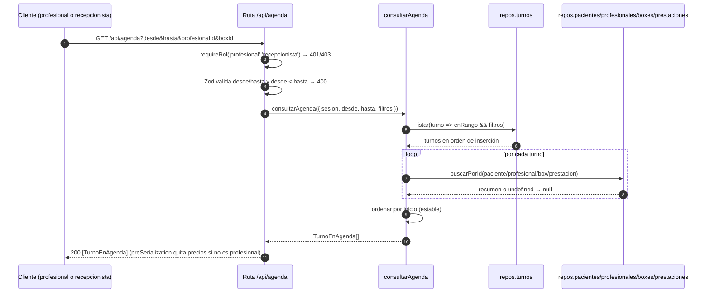
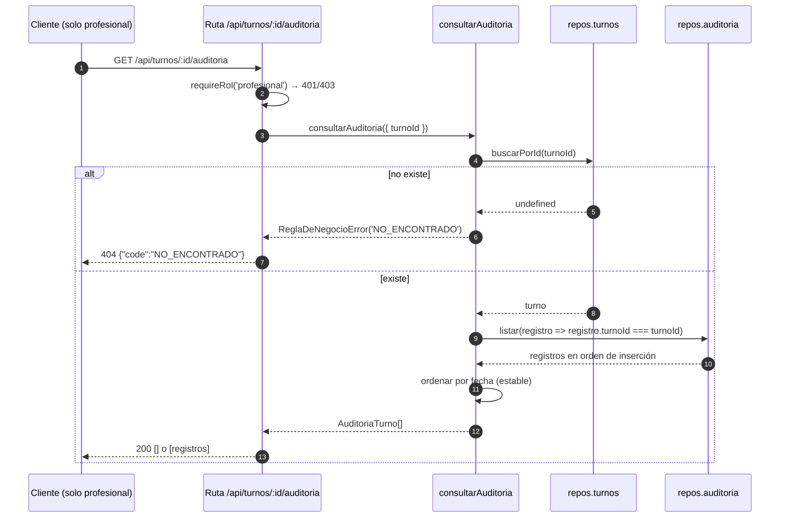

# Design

## Context

Ver `proposal.md` §Why. Este change agrega solo lectura sobre contratos ya congelados por C-01:

- `src/shared/entidades.ts`: `Turno`, `AuditoriaTurno`, `Paciente`, `Profesional`, `Box`, `Prestacion`.
- `src/shared/repositorios.ts`: `repos.turnos.listar(filtro)`, `repos.auditoria.listar(filtro)` (append-only), `buscarPorId` de pacientes, profesionales, boxes y prestaciones. `EnMemoria.listar` devuelve las entidades en **orden de inserción**.
- `src/shared/sesion.ts`: `UsuarioSesion`, `requireRol(...)`, `sesionDe(request)`. `src/app.ts` autentica toda ruta no pública y mapea 400/401/403/404/409.
- `src/shared/precios.ts`: `sinPrecioPara(rol, valor)` corre en `preSerialization` a cualquier profundidad; oculta `precio` y `precioAlReservar` a recepción y paciente.
- `src/app.ts`: registra cada `src/modules/*/routes.ts` con prefijo `/api` por autoload; no se edita ningún router central.
- Patrón de validación de rango: `src/modules/ganancias/routes.ts` usa `z.string().datetime({offset:true})` + `superRefine` con el issue en `path: ['hasta']`.
- Escritores de auditoría ya mergeados: C-02 guarda `detalle: { despues: turno }` en `creado`; C-05 guarda `detalle: { antes: { estado }, despues: { estado } }` en `cancelado`/`estado_cambiado`, con registros de reversión `{ revertido: true }`. C-10 agregará `reprogramado`. Este change **no los interpreta ni los modifica**.

Restricción de proceso: governance CRITICO, rama `dev-agustin`, solo se escribe en `src/modules/agenda/`, `tests/agenda/` y `openspec/changes/agenda-y-auditoria/`.

## Goals / Non-Goals

**Goals:**

- Publicar `GET /api/agenda?desde&hasta&profesionalId&boxId` para profesional y recepcionista, con turnos del rango semiabierto `[desde, hasta)`, enriquecidos y ordenados por `inicio`.
- Publicar `GET /api/turnos/:id/auditoria` para el profesional, con los registros append-only ordenados por `fecha`.
- Respetar el contrato de errores existente (`400 FORMATO_INVALIDO`, `401 NO_AUTENTICADO`, `403 SIN_PERMISO`, `404 NO_ENCONTRADO`) sin agregar códigos.
- Cubrir cada escenario del spec con un test de Vitest (TDD) y no exponer precios a la recepción.

**Non-Goals:**

- No se crean ni modifican turnos, auditoría, agendas ni agendas de disponibilidad: no hay `POST`, `PATCH` ni `DELETE`.
- No se resuelven nombres de actores ni de pacientes para la auditoría (D6).
- No se implementan pantallas: la agenda visual es C-13 y la auditoría visual es C-15 (D9).
- No se toca `src/shared/`, `src/app.ts`, `package.json`, `tsconfig*` ni la configuración de Vitest.
- No se agrega paginación, caché ni límite de tamaño del rango: la escala del consultorio es de decenas de turnos por día y los repos son en memoria.

## Decisions

### D1. Contrato del rango: obligatorio, ISO 8601 con offset, `[desde, hasta)`

`desde` y `hasta` son obligatorios. Se validan con `z.string().datetime({ offset: true })`, igual que `ganancias`, y `superRefine` agrega el issue en `path: ['hasta']` cuando `new Date(desde).getTime() >= new Date(hasta).getTime()`. El filtro se aplica sobre `turno.inicio` con `desde <= inicio < hasta`.

**Rationale:** el rango semiabierto evita el doble conteo en consultas consecutivas y es coherente con `[inicio, fin)` de la agenda (RN-AG-04) y con el período de `ganancias`. Comparar `getTime()` es comparar instantes: el módulo no hace aritmética de zona horaria (DD-08), así que no le afecta el `APP_TZ`.

**Alternativas descartadas:** rango inclusivo `[desde, hasta]` duplicaría turnos en los bordes entre días; aceptar fechas sin offset obligaría a asumir una zona y rompería el contrato del resto de la API.

`desde >= hasta` es un error de formato (`400`), no una regla de negocio (`409`): no hay ningún recurso en un estado inválido, hay una consulta mal formada. Un rango de duración cero no tiene sentido y también da `400`.

### D2. `profesionalId` y `boxId` opcionales, combinables con AND; un id inexistente devuelve `[]`

Ambos son `z.string().min(1).optional()`. La consulta filtra por `profesionalId` si vino, por `boxId` si vino, y combina los dos con AND. Sin filtros devuelve todos los turnos del rango.

**Rationale:** son predicados sobre la colección, no recursos solicitados. `404` se reserva para el recurso identificado en el path (`/turnos/:id/auditoria`). Un filtro que no coincide con nada es una consulta válida con resultado vacío, igual que un rango sin turnos. Devolver `404` obligaría a distinguir "id inexistente" de "id existente sin turnos" y filtraría la existencia de profesionales/boxes por el código de estado.

**Alternativa descartada:** validar que el `profesionalId`/`boxId` exista y responder `404` si no. Se descarta porque complica la UI (un box recién creado sin turnos da `[]` de todos modos) y porque no hay borrado de profesionales ni boxes en el MVP.

### D3. Orden determinista y estable

Agenda: `inicio` ascendente. Auditoría: `fecha` ascendente. En ambos casos, ante empates se preserva el orden de inserción del repositorio.

**Rationale:** `Array.prototype.sort` es estable por especificación (ES2019), pero para que el orden sea explícito y no dependa del motor, el dominio ordena con un índice de entrada como desempate: `(a, b) => a.fecha - b.fecha || a.indice - b.indice`. Así el escenario "empate conserva el orden de inserción" es determinista y testeable. No se desempata por `id` porque los ids son `randomUUID()` y no aportan un orden útil.

### D4. Forma de la respuesta de `/api/agenda`: array plano enriquecido

La respuesta es un array JSON plano (el patrón de `GET /api/profesionales`), no un objeto con metadatos. Cada elemento extiende `Turno` con resúmenes:

```
TurnoEnAgenda = Turno & {
  paciente:    { id, nombre, apellido } | null
  profesional: { id, nombre } | null
  box:         { id, nombre } | null
  prestacion:  { id, nombre, duracionMin } | null
}
```

`precioAlReservar` se conserva porque es parte de `Turno` y porque el profesional lo necesita; el serializador global lo quita para la recepción y el paciente. El resumen de `prestacion` **no** incluye `precio` por diseño, para no depender solo del serializador.

**Invariante de integridad referencial:** los repositorios en memoria no borran turnos (RN-TU-03: "eliminar" es cancelar) ni borran profesionales, boxes, prestaciones o pacientes (no hay ruta de borrado). Por eso, con datos consistentes, los cuatro resúmenes siempre existen. Si una referencia faltara por datos inconsistentes, el caso de uso es defensivo y devuelve `null` en ese resumen en vez de lanzar: una agenda no debe romperse entera por un turno huérfano. No se agrega un escenario al spec porque no es un comportamiento exigido ni alcanzable por la API; queda como decisión de robustez.

**Alternativa descartada:** devolver `{ turnos: [...] }`. Rompe el patrón de listas del proyecto y obliga a la UI a desempaquetar.

### D5. Roles y alcance

- `/api/agenda`: `requireRol('profesional', 'recepcionista')`.
- `/api/turnos/:id/auditoria`: `requireRol('profesional')`.

El profesional ve **toda** la agenda y la auditoría de **cualquier** turno, no solo los suyos (PA-09). Solo sus ganancias están restringidas (RN-RO-02, C-08).

**Rationale:** la matriz RBAC da `L` de turnos a los tres roles en lectura (el paciente solo los propios, por C-11) y `L` de auditoría solo al profesional. En un consultorio de 1 a 3 profesionales que comparten boxes y recepción, restringir la agenda al dueño impediría cubrir ausencias y organizar el día. La auditoría tampoco agrega una restricción de dueño porque el profesional ya ve el turno en la agenda; inventar una restricción sería una regla nueva no pedida.

### D6. Auditoría cruda: se devuelve lo guardado, sin resolver actores

La respuesta es el array de `AuditoriaTurno` tal como está guardado: `id`, `turnoId`, `accion`, `actor`, `fecha`, `detalle`. No se traduce `actor` a un nombre ni se normaliza `detalle`.

**Rationale:** el contrato congela `actor` como `usuarioId` o `"paciente"`; resolverlo requeriría leer `repos.usuarios` y decidir qué hacer con actores que no son usuarios (el paciente) o con usuarios inactivos. No está en el alcance de C-07 y el spec lo deja explícito como no-goal. Tampoco se reinterpreta `detalle` porque cada escritor guarda una forma distinta (`despues: turno` en C-02, `antes/despues: { estado }` en C-05, `revertido: true` en las reversiones) y la consulta debe ser estable ante cambios de esos módulos.

**Alternativa descartada:** devolver `actorNombre`. Acopla C-07 a C-04 (usuarios) y a la forma de cada `detalle`; cualquier cambio en un escritor rompería la consulta.

### D7. Turno inexistente vs. turno sin registros

Si `repos.turnos.buscarPorId(id)` no devuelve nada, el caso de uso lanza `ReglaDeNegocioError('NO_ENCONTRADO')` → `404`. Si el turno existe pero `repos.auditoria.listar(...)` devuelve `[]`, responde `200 []`.

**Rationale:** distingue "no existe el turno" de "no pasó nada todavía", que son cosas distintas para la UI. Reutiliza el código `NO_ENCONTRADO` ya definido en C-01 (no se agregan códigos a RN-EX-01).

### D8. Solo lectura, sin rutas de escritura

El módulo registra únicamente dos `GET`. No hay `POST`, `PATCH` ni `DELETE` sobre `/agenda` ni sobre `/turnos/:id/auditoria`. Cualquier método distinto cae en el `notFoundHandler` global de `src/app.ts` y responde `404 {code:'NO_ENCONTRADO'}`.

**Rationale:** la auditoría es append-only (RN-TU-05) y la escriben los casos de uso de C-02, C-05 y C-10 en el momento de la acción, no una ruta. Exponer una ruta de escritura permitiría falsificar el audit trail. Se prueba explícitamente que `PATCH` y `DELETE` dan `404` para que nadie los agregue por error.

### D9. Sin interfaz web en este change

La API es la única entrega. La agenda visual es C-13 (`web-recepcion`) y la auditoría visual es C-15 (`web-profesional`).

**Rationale:** C-07 es backend; la política visual `system-and-mockups` aplica a cambios con UI, y este no tiene. Se registra `Decision: no (no UI)` en `## UI Mockups`.

### D10. Supuesto PA-09 aplicado

PA-09 ("¿el profesional puede ver los turnos de otros profesionales o solo los suyos?") está sin responder por EP. Se aplica el supuesto documentado en la KB y en `CHANGES.md`: **el profesional ve toda la agenda, pero solo sus ganancias**. Si EP responde lo contrario antes de `apply`, hay que revisar D5 y los escenarios de acceso de la agenda; el cambio sería acotar el filtro por `sesion.profesionalId`. Se deja anotado en este `design.md`.

## Contratos

### `GET /api/agenda`

Query:

| Parámetro | Obligatorio | Formato | Semántica |
|---|---|---|---|
| `desde` | sí | ISO 8601 con offset | borde inferior inclusivo sobre `inicio` |
| `hasta` | sí | ISO 8601 con offset | borde superior exclusivo sobre `inicio` |
| `profesionalId` | no | string no vacío | filtra por profesional |
| `boxId` | no | string no vacío | filtra por box |

Ejemplo: `GET /api/agenda?desde=2026-11-23T12:00:00Z&hasta=2026-11-24T12:00:00Z&boxId=<id-box-1>`

Respuesta `200` (rol profesional; para recepción no aparecen `precioAlReservar` ni `precio`):

```json
[
  {
    "id": "00000000-0000-4000-8000-000000000701",
    "inicio": "2026-11-23T13:00:00.000Z",
    "fin": "2026-11-23T13:30:00.000Z",
    "estado": "reservado",
    "origen": "recepcion",
    "precioAlReservar": 15000,
    "creadoPor": "00000000-0000-4000-8000-000000000603",
    "creadoEn": "2026-11-22T18:00:00.000Z",
    "paciente": { "id": "00000000-0000-4000-8000-000000000501", "nombre": "Paciente", "apellido": "Ficticio Uno" },
    "profesional": { "id": "00000000-0000-4000-8000-000000000101", "nombre": "Dra. Ana Pérez" },
    "box": { "id": "00000000-0000-4000-8000-000000000201", "nombre": "Box 1" },
    "prestacion": { "id": "00000000-0000-4000-8000-000000000301", "nombre": "Consulta", "duracionMin": 30 }
  }
]
```

### `GET /api/turnos/:id/auditoria`

Sin query ni cuerpo. Respuesta `200`:

```json
[
  {
    "id": "00000000-0000-4000-8000-000000000801",
    "turnoId": "00000000-0000-4000-8000-000000000701",
    "accion": "creado",
    "actor": "00000000-0000-4000-8000-000000000603",
    "fecha": "2026-11-22T18:00:00.000Z",
    "detalle": { "despues": { "id": "00000000-0000-4000-8000-000000000701", "estado": "reservado" } }
  },
  {
    "id": "00000000-0000-4000-8000-000000000802",
    "turnoId": "00000000-0000-4000-8000-000000000701",
    "accion": "estado_cambiado",
    "actor": "00000000-0000-4000-8000-000000000601",
    "fecha": "2026-11-23T12:10:00.000Z",
    "detalle": { "antes": { "estado": "reservado" }, "despues": { "estado": "confirmado" } }
  }
]
```

### Tabla de errores

| Caso | HTTP | Cuerpo |
|---|---|---|
| Falta `desde` o `hasta`, un valor no es ISO 8601 con offset, o `desde >= hasta` | `400` | `{"code":"FORMATO_INVALIDO","detalles":[{"campo":"hasta","motivo":"…"}]}` |
| Sin sesión en cualquiera de las dos rutas | `401` | `{"code":"NO_AUTENTICADO"}` |
| Paciente en `/api/agenda`, o recepción/paciente en `/api/turnos/:id/auditoria` | `403` | `{"code":"SIN_PERMISO"}` |
| Turno inexistente en `/api/turnos/:id/auditoria` | `404` | `{"code":"NO_ENCONTRADO"}` |
| `PATCH` o `DELETE` sobre `/api/turnos/:id/auditoria` (o cualquier método no registrado) | `404` | `{"code":"NO_ENCONTRADO"}` |
| Turno existente sin registros de auditoría | `200` | `[]` |
| Rango o filtro sin turnos | `200` | `[]` |

No se agregan códigos de negocio: `NO_ENCONTRADO`, `FORMATO_INVALIDO`, `NO_AUTENTICADO` y `SIN_PERMISO` ya existen.

## Flujo





## Estrategia de tests (TDD)

Un test que falla primero por cada escenario del spec. Tres cortes verticales, de adentro hacia afuera:

1. **Dominio puro** (`src/modules/agenda/dominio/agenda.ts`): `turnosEnRango`, `filtrarPorRecursos`, `ordenarPorInicio`, `ordenarPorFecha`. Sin Fastify, sin repos, sin `Date.now()`: reciben arrays y devuelven arrays nuevos. Se prueba con turnos literales y fechas `new Date('…Z')` fijas.
2. **Casos de uso** (`src/modules/agenda/aplicacion/`): `consultarAgenda` y `consultarAuditoria` con `crearRepositoriosEnMemoria()` y `SEED`. Se verifica el enriquecimiento, el `null` defensivo, el `404` del turno inexistente y que la auditoría no se filtre por dueño. Nada de `vi.mock`: los repos en memoria son la implementación real del puerto.
3. **Rutas** (`tests/agenda/routes.test.ts`): `buildApp({ auth, repos, clock })` + `app.inject()`, cierre en `afterEach`. `authDeTest` de `tests/plataforma/helpers.ts` cubre profesional (Ana), recepción y paciente; para la sesión de Bruno se envuelve en un `AuthPort` local como en `tests/ganancias/fixtures.ts`. `FixedClock` en 2026-11-23T12:00:00Z. Se cubren acceso (401/403), validación (400), no-precio para recepción, `404` de auditoría, orden y solo lectura (PATCH/DELETE → 404).

Reglas de los tests: nombres de `it` iguales al escenario del spec; `toEqual`/`toBe`/`rejects.toMatchObject({ code })`; fechas dentro del horario semilla; datos 100 % ficticios; un `it` por escenario, más los casos de integración propios de la ruta.

## Risks / Trade-offs

- **[El audit trail queda visible para todos los profesionales]** → Es el supuesto PA-09 y la matriz RBAC (`Auditoría de turnos: L` solo profesional). Mitigación: spec aprobado por EP antes de `apply`; no se expone a recepción ni a paciente.
- **[La consulta depende de la forma de `detalle` que escriben C-02, C-05 y C-10]** → No se interpreta: se devuelve el `Record<string, unknown>` tal cual. Un cambio en un escritor no rompe C-07.
- **[La recepción podría recibir precios si el serializador global fallara]** → Además de `sinPrecioPara`, el resumen de `prestacion` se construye sin `precio`; un test de ruta verifica la ausencia de `precioAlReservar` y de `precio` en dos niveles.
- **[Orden no determinista en empates]** → Se ordena con índice de entrada como desempate explícito, no se confía solo en la estabilidad del motor.
- **[Rangos enormes]** → En memoria y a escala de consultorio (decenas de turnos por día) es aceptable. Si el adaptador SQLite llega (DD-07), el filtro se empuja a la consulta; no cambia el contrato.
- **[Un turno huérfano por datos inconsistentes]** → El enriquecimiento devuelve `null` en el resumen faltante en vez de fallar la agenda completa. La invariante real (sin borrado) hace que no ocurra por la API.

## Open Questions

Ninguna. EP aprobó el spec el 2026-11-23 (governance CRITICO) y se mantiene el supuesto PA-09 de D10: el profesional ve toda la agenda y la auditoría de cualquier turno.

## UI Mockups

- Design system revision: 2
- Decision: no (no UI)
- Approval: n/a
- Preview: n/a
- Visual verify: n/a
